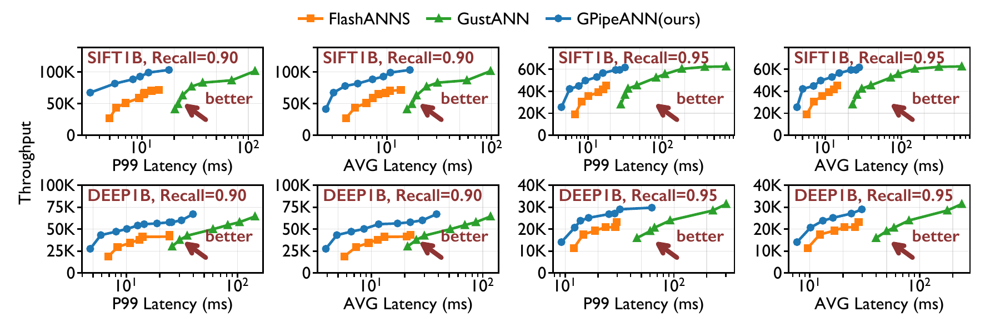

<p align="center">
  
</p>

<h3 align="center">
A low-latency, high-throughput, and billion-scale GPU-SSD vector search system.
</h3>

<p align="center">
  <a href="README-AE.md"><strong>ATC'26 Artifact Evaluation Guide</strong></a>
</p>

## ✨ Key Features

| Feature | Description |
|---------|-------------|
| ⚡&nbsp;**Ultra-Low&nbsp;Latency** | 2.94 ms P99 on SIFT-1B and 4.73 ms P99 on DEEP-1B (top-10, 90% recall, 4 SSDs) |
| 📈&nbsp;**High&nbsp;Throughput** | 104.5K QPS on SIFT-1B and 59.5K QPS on DEEP-1B (top-10, 90% recall, 4 SSDs) |
| 🌐&nbsp;**Billion-Scale&nbsp;Search** | Searches SIFT-1B and DEEP-1B on a single 40 GB GPU, with the billion-scale graph stored on NVMe SSDs |
| 💾&nbsp;**Memory&nbsp;Efficient** | Keeps only 32 GB PQ codes in GPU memory instead of loading the full graph into GPU memory |
| 🐍&nbsp;**Easy-to-Use** | Both Python (`NumPy`-native) and C++ interfaces are supported |
| 🔌&nbsp;**Flexible&nbsp;Backends** | Use SPDK for direct NVMe access, or the ordinary-file block backend for debugging |
| 🗄️&nbsp;**Direct&nbsp;NVMe&nbsp;I/O** | SPDK-based userspace I/O supports direct access to one or multiple NVMe SSDs with page-level striping |

> Results use Recall@10 = 0.90 on an NVIDIA A100 40 GB GPU with four NVMe SSDs.

## 📊 Performance Comparison

GPipeANN is suitable for both **high-throughput** and **latency-sensitive** billion-scale ANNS.

| Dataset | Dimension | Recall@10 | P99 Target | GPipeANN | FlashANNS | GustANN |
|---------|-----------|-----------|------------|--------|-----------|---------|
| SIFT-1B | 128 | 0.90 | ≤10 ms | ✅ **97.8K QPS** | 63.8K QPS | ❌ 20.4 ms minimum P99 |
| DEEP-1B | 96 | 0.90 | ≤10 ms | ✅ **45.0K QPS** | 26.8K QPS | ❌ 33.8 ms minimum P99 |
| SIFT-1B | 128 | 0.95 | ≤10 ms | ✅ **42.5K QPS** | 28.6K QPS | ❌ 29.5 ms minimum P99 |
| DEEP-1B | 96 | 0.95 | ≤10 ms | ✅ **12.7K QPS** | ❌ 12.8 ms minimum P99 | ❌ 51.7 ms minimum P99 |

> Recall@10 = 0.90/0.95, NVIDIA A100 40 GB GPU, four Samsung PM1743 NVMe SSDs.

<p align="center">
  
</p>

### Baseline provenance

No official FlashANNS source release was publicly available to us. The
FlashANNS source included in this repository is therefore an independent
reimplementation by the GPipeANN authors based on the published paper, not an
official implementation from the FlashANNS authors. This reimplementation is
open source under the repository's Apache License 2.0. See the
[FlashANNS baseline README](src/flashanns/README.md) for implementation details
and configuration instructions.

---

## 🚀 Quick Start

For best performance, we recommend Ubuntu 24.04 with CUDA 12.x and SPDK-compatible NVMe SSDs.

### 🏗️ Build

Install the build dependencies:

```bash
git submodule update --init --recursive --depth 1
sudo apt-get update
sudo apt-get install -y build-essential cmake python3-dev python3-pip python3-venv

# Install SPDK dependencies and build the bundled SPDK.
sudo deps/spdk/scripts/pkgdep.sh
cd deps/spdk && ./configure && make -j8
cd ../..
```

Build the GPipeANN search engine and SSD writer:

```bash
export PATH=/usr/local/cuda-12.8/bin:"$PATH"  # Adjust for your CUDA 12.x install.
cmake -S . -B build \
  -DCMAKE_BUILD_TYPE=Release \
  -DGPIPEANN_ENABLE_SPDK=ON \
  -DGPIPEANN_BUILD_STRAWMEN=OFF
cmake --build build -j"$(nproc)" --target gpipeann_search spdk_write
```

Install the Python interface:

```bash
python3 -m venv .venv
source .venv/bin/activate
pip install -e .
```

### ⚡ C++

Search an existing on-disk index with GPipeANN:

```bash
SPDK_BASE_LBA=0 build/bin/gpipeann_search \
  --index-dir /path/to/index \
  --query /path/to/query.u8bin \
  --data-type uint8 \
  --topk 10 \
  --ef-search 45 \
  --ssd-list-file /path/to/ssd_list.txt \
  --repeat 1 \
  --result-prefix /tmp/gpipeann-result
```

The result IDs and distances are written to `/tmp/gpipeann-result_ids.bin` and `/tmp/gpipeann-result_distances.bin`. Omit `--ssd-list-file` to use the debug backend, which reads blocks from the ordinary index file through the same loader interface. There is no heap/mmap mode selector.

### 🐍 Python

```python
import numpy as np

from gpipeann import IndexGPipeANN

query_file = "/path/to/query.u8bin"
count, dimensions = np.fromfile(query_file, dtype="<i4", count=2)
queries = np.fromfile(query_file, dtype=np.uint8, offset=8).reshape(count, dimensions)

idx = IndexGPipeANN(
    index_dir="/path/to/index",
    data_type="uint8",
    ssd_list_file="/path/to/ssd_list.txt",
    spdk_base_lba=0,
)

ids, distances = idx.search(queries, topk=10, ef_search=45)
```

`queries` is a two-dimensional NumPy array. Pass PCI addresses directly through `ssds=[...]`, or use an existing `ssd_list_file`, to select the SPDK backend. Omit both options to read blocks from the ordinary index file for debugging. The `memory_backend` Python argument and `--memory-backend` CLI selector have been removed.

See the [Artifact Evaluation Guide](README-AE.md) for CUDA installation, index preparation, SPDK device binding, and full experiment reproduction.

Plotting scripts and saved figure inputs are included in [paper-plots](paper-plots/README.md). Run `python3 paper-plots/scripts/plot_figures.py` to redraw them without SPDK or a GPU.

## License

GPipeANN is licensed under the [Apache License 2.0](LICENSE). Bundled third-party
components retain their respective licenses; see [NOTICE](NOTICE) and the
license files shipped with those components.

## 📰 Updates

- **Sep 24, 2026**: Initial release with billion-scale GPU-SSD search, C++ and Python interfaces, and SPDK and memory backends

---

## 📖 Citation

GPipeANN was inspired by [PipeANN](https://github.com/thustorage/PipeANN) and its [OSDI '25 paper](https://www.usenix.org/conference/osdi25/presentation/guo) on pipelined graph-based vector search over SSDs.

If you use GPipeANN in your research, please cite our forthcoming ACM SIGOPS ATC '26 paper:

The accompanying artifact is permanently archived on Zenodo at
[doi:10.5281/zenodo.23074357](https://doi.org/10.5281/zenodo.23074357).

```bibtex
@inproceedings{wu2026gpipeann,
  author    = {Puqing Wu and Minhui Xie and Yiheng Tong and Jie Yin and
               Sen Yang and Yunpeng Chai},
  title     = {GPipeANN: Taming Throughput-Latency Tradeoff in GPU-SSD ANNS},
  booktitle = {ACM SIGOPS Annual Technical Conference (ACM SIGOPS ATC '26)},
  year      = {2026},
  note      = {To appear}
}

@inproceedings{guo2025pipeann,
  author    = {Hao Guo and Youyou Lu},
  title     = {Achieving Low-Latency Graph-Based Vector Search via Aligning Best-First Search Algorithm with SSD},
  booktitle = {19th USENIX Symposium on Operating Systems Design and Implementation (OSDI 25)},
  year      = {2025},
  pages     = {171--186},
  publisher = {USENIX Association},
  url       = {https://www.usenix.org/conference/osdi25/presentation/guo}
}
```
